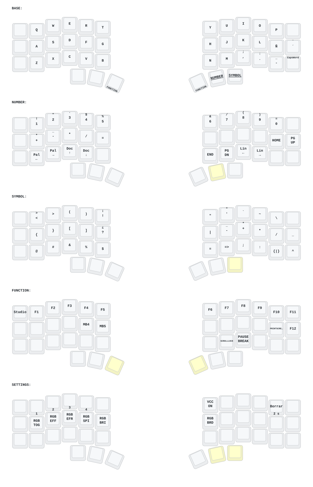

# Corne Dongle - ZMK Keyboard Configuration

ZMK firmware configuration for a wireless 42-key Corne with a USB dongle, tuned for macOS with the Spanish (Spain) ISO layout.

## Hardware

- 3x nice!nano v2: central dongle, left half, right half
- Dongle display: SH1106 OLED over I2C
- Halves display: nice!view over SPI

## Keymap

| Layer | Activation | Content |
|-------|------------|---------|
| 0 BASE | Default | QWERTY with ñ and ´ |
| 1 NUMBER | Hold `mo 1` | Numbers, operators, nvim-style navigation |
| 2 SYMBOL | Hold `mo 2` | Symbols, tap dances, `=>` and `{}` macros |
| 3 FUNCTION | Hold Space or Enter | F1-F12, media, mouse clicks |
| 4 SETTINGS | Hold `mo 1` + `mo 2` | Devices, RGB, bootloader |

Keep macOS on the Spanish layout, including when writing English: all keycodes assume it, and the firmware cannot detect the active OS layout.

### Switching devices

On SETTINGS, the keys under digits 1-4 select Bluetooth profiles 1-4 and also switch the output to Bluetooth. The key under 5 switches to USB.

Holding P for 2 seconds unpairs the active profile only. There is deliberately no clear-all key. To pair a device again, select its profile, hold P for 2 seconds, and pair from the device.

## Displays

- **Dongle:** [zmk-dongle-display](https://github.com/englmaxi/zmk-dongle-display) shows layer, output, battery, WPM and Mac modifiers.
- **Halves:** the in-repo `corne_view` shield (`config/boards/shields/corne_view`), based on ZMK's own nice!view widget. It shows battery, connection and a fixed logo. After 30 seconds without using that half, its display turns off with the RGB strip, since both share VCC. It comes back when you press a key on that half.

The image is the LazyVim dashboard logo. To change it, replace `logo_map` in `widgets/art.c` with a 140x68, 1-bit image, stored rotated so the top of the picture is the right edge of each row. Colors are inverted by `CONFIG_CORNE_VIEW_WIDGET_INVERTED=y` in `corne_view.conf`.

Peripherals cannot show the active layer or modifiers: only the central knows them.

## Power

- **Halves:** deep sleep after 30 minutes without use. A key press wakes them.
- **Dongle:** runs on battery or USB. On battery, it enters deep sleep after 8 hours without use. No key can wake it, so it then needs the reset button. It never enters deep sleep while USB power is present.

## Building and flashing

GitHub Actions builds the firmware on every push. Download the artifacts from the run, then for each board:

1. Double-tap the reset button. On a half, SETTINGS has bootloader keys, but the dongle needs its physical button.
2. Copy the matching `.uf2` file to the drive that appears.

Flash `settings_reset` only to wipe a board's saved settings and pairings.

## ZMK Studio

The dongle firmware includes ZMK Studio. Connect the dongle over USB and open [zmk.studio](https://zmk.studio/).

## Acknowledgments

- [ZMK Firmware](https://zmk.dev/)
- [Corne keyboard](https://github.com/foostan/crkbd)
- [zmk-dongle-display](https://github.com/englmaxi/zmk-dongle-display) by englmaxi
